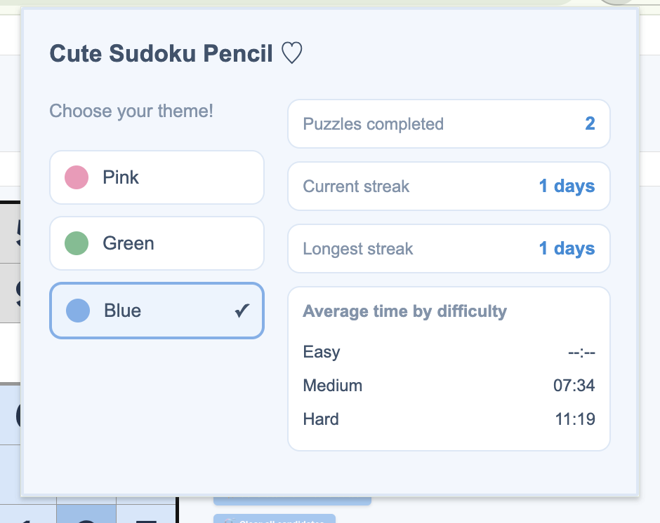

# 🌸🎀 Cute Sudoku Pencil ♡⊹˚₊

A Chrome extension for NYT Sudoku~~ 
Making your daily solving experience easier and prettier ♡ 

## Features ⋆
- Choose between three colour themes: pink (default), green and blue 
- Automatically generate and fill valid pencil candidates whenever you like, without being restricted to NYT Auto Candidate Mode 
- View your solved sudoku statistics in a cute popup interface! 

## Preview ⋆

### Sudoku board without candidates

### Sudoku board with generated candidates edited manually (no NYT Auto mode)

### Extension popup with blue theme selected

## Installation ⋆

1. Download the latest version from the GitHub Releases page: 
&nbsp;&nbsp;&nbsp;`https://github.com/hmdworks/cute-sudoku-pencil/releases`
2. Extract the downloaded ZIP file
3. Go to `chrome://extensions` in Chrome
4. Turn on <b>Developer mode</b>
5. Click <b>'Load unpacked'</b>
6. Select the `cute-sudoku-pencil` folder
7. Navigate to an NYT Sudoku page e.g. `https://www.nytimes.com/puzzles/sudoku/medium`
8. <i>Happy solving!~~</i>
